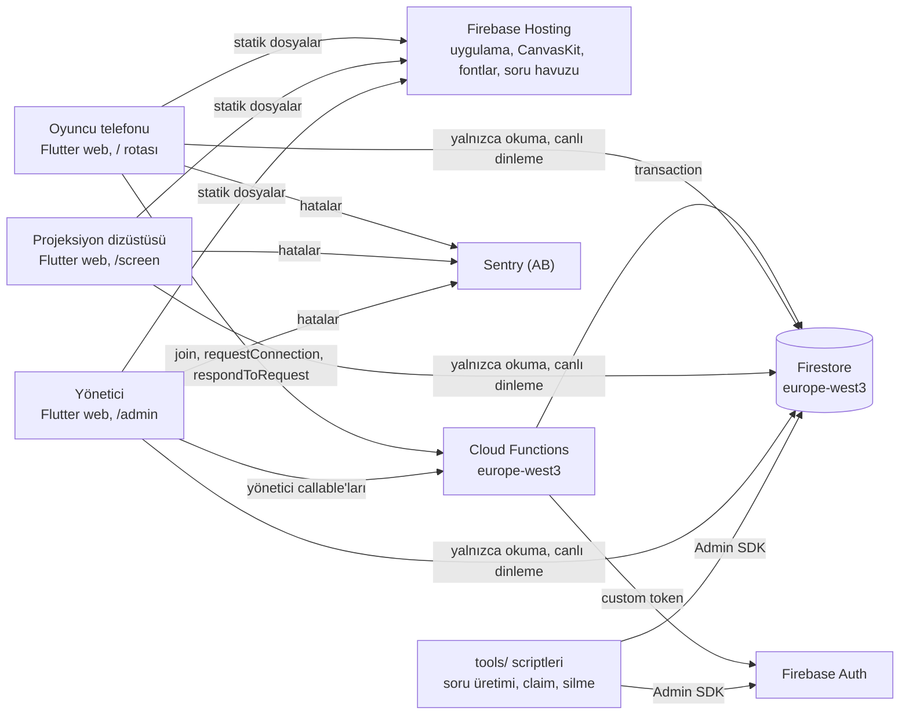
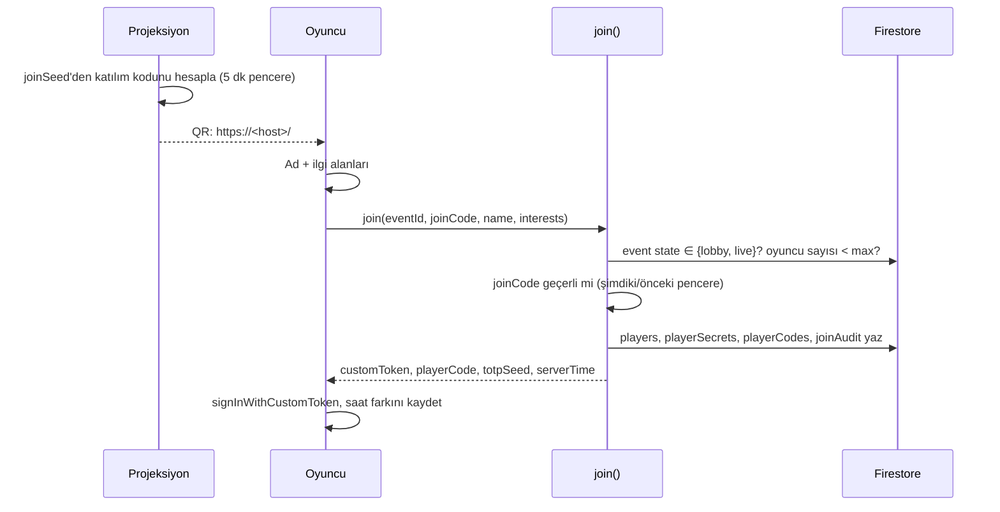
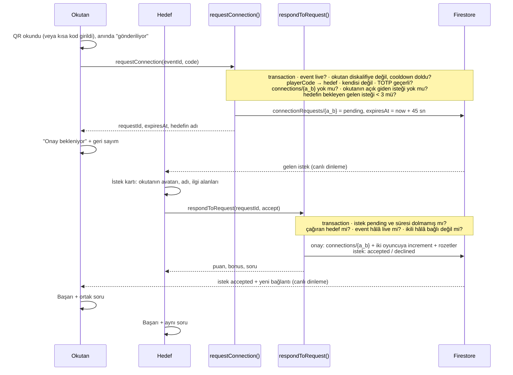

# Bağlantı Ağı: Mimari

- **Sürüm:** 0.1 (taslak)
- **Tarih:** 2026-10-22
- **Girdiler:** `01-requirements.md`, `05-security.md`, `../research/00-summary.md` (kararlar D1-D6)
- **Kararlar:** Kalıcı kararların gerekçeleri `../adr/` altında. Bu doküman "sistem nasıl çalışıyor" sorusunu cevaplar, "neden böyle" için ADR'lara bağlantı verir.

## 1. Sistem bağlamı



**Temel ilke:** İstemci Firestore'a hiçbir oyun verisi yazmaz. Bütün yazmalar Cloud Functions'tan geçer, istemci yalnızca okur ve dinler. Böylece oyun kuralları tek bir yerde, test edilebilir TypeScript kodunda durur (ADR-0002).

## 2. Repo yapısı

```
baglanti-agi/
  app/                      Flutter web uygulaması (tek uygulama, üç yüzey)
  functions/                Cloud Functions (TypeScript, Node 22)
  firebase/                 firestore.rules, firestore.indexes.json, rules-tests/
  shared/                   catalog/interests.json (ilgi alanı kataloğu: kimlik, ad, küme, renk)
                            test-vectors/ (Dart ve TS'in birlikte koştuğu jeton/puan/ad normalizasyonu vektörleri)
  tools/                    question-gen/, set-claims/, purge-event/, loadtest/
  docs/                     spesifikasyonlar, araştırma, ADR'lar
  .github/workflows/        CI/CD
  firebase.json, .firebaserc, .fvmrc
```

Dart pub workspace kullanılmıyor: Dart kodunu paylaşacak ikinci bir Dart tüketicisi yok. Dart ve TypeScript arasındaki ortak mantık (jeton, puan) kod olarak değil, **ortak test vektörleriyle** senkron tutulur (§7.4).

## 3. İstemci mimarisi (ADR-0001, ADR-0005)

### 3.1 Yüzeyler ve yükleme

| Rota | Yüzey | Yükleme | Kimlik |
|---|---|---|---|
| `/#/` | Oyuncu | Ana bundle | Custom token (`join`) |
| `/#/screen` | Projeksiyon | `deferred` import | Google + `projector` claim |
| `/#/admin` | Yönetici | `deferred` import | Google + `admin` claim |

- Derleme: `flutter build web --release --source-maps --no-web-resources-cdn`, dart2js + CanvasKit, Flutter 3.47.7 (fvm ile sabit).
- URL stratejisi: hash. Hosting'de yönlendirme kuralı gerekmez, katılım kodu fragment'ta taşınır ve sunucu loglarına düşmez.
- `index.html` içinde Flutter yüklenene kadar görünen düz HTML açılış ekranı ve uygulama içi tarayıcı tespiti (§10).

### 3.2 Katmanlar

```
presentation  (widget'lar, ekranlar)            → application'ı izler
application   (Riverpod Notifier/Provider)      → domain'i kullanır, data'yı çağırır
domain        (saf Dart: modeller, kurallar)     ← hiçbir şeye bağımlı değil
data          (Firestore/Functions repository)   → domain modellerini üretir
platform      (kamera, ekranı açık tutma, tarayıcı tespiti; package:web)
```

- `domain/` altında `package:flutter`, `cloud_firestore`, `firebase_*` importu yasak. CI'da bir grep adımı kontrol eder.
- Bağımlılık enjeksiyonu Riverpod provider'larıyla. Testte `ProviderContainer(overrides: ...)` ile sahte repository takılır.
- Platform API'leri (kamera, wake lock) bir arayüzün arkasında. Testte ve masaüstü geliştirmede sahte sürüm kullanılır.

### 3.3 Klasörler

```
app/lib/
  main.dart                    Sentry init, global hata yakalayıcılar, ProviderScope
  app/                         router.dart, theme/, env.dart, error_view.dart, boot/
  core/
    domain/                    result.dart, failures.dart, event_state.dart, scoring.dart,
                               token.dart (TOTP), player_code.dart, models/
    data/                      firestore_paths.dart, converters.dart, functions_client.dart
    platform/                  camera_scanner.dart (+ web impl), wake_lock.dart, browser_info.dart
    observability/             error_reporter.dart, sentry_reporter.dart, app_event.dart, scrub.dart
  features/
    join/                      presentation/, application/, data/
    play/                      kendi QR'ım, okutma, elle kod, bağlantı listesi, ortak soru
    badges/                    (P1) rozet modeli, Rive/Flutter sunumu
    summary/                   (P1) oyun sonu özeti
    projector/   (deferred)    graph/, leaderboard/, lobby/, winners/
    admin/       (deferred)    state_control/, health/, review/, archive/
  l10n/                        app_tr.arb, app_en.arb
```

### 3.4 Durum yönetimi ve veri akışı

- Riverpod 3, kod üretimi yok. Firestore akışları `StreamProvider` olur.
- Oyuncu yalnızca şunları dinler: etkinlik belgesi, kendi oyuncu belgesi (puan ve sunucunun yazdığı sıra dahil), kendi bağlantıları (`participants array-contains uid`, `limit 100`), kendine gelen bekleyen istekler (`targetUid == uid`, `status == pending`, `limit 3`) ve kendi giden isteği. Global sıralamayı dinlemez (ADR-0011, ADR-0014).
- Projeksiyon tüm `players` ve `connections` akışlarını dinler, sıralamayı ve sayaçları kendi hesaplar.
- Modeller elle yazılır: Dart 3.13 primary constructors, `sealed` sınıflar, elle `fromJson`/`toJson`. Model sayısı 12'yi geçerse `dart_mappable`'a geçilir.

### 3.5 Hata modeli

```dart
sealed class Result<T> { ... }      // Ok<T> | Err<T>(GameFailure)

sealed class GameFailure {
  // Beklenen, kullanıcıya anlamlı mesajla gösterilen durumlar
  tokenExpired | tokenInvalid | alreadyConnected | selfScan | notLive |
  rateLimited | joinCodeInvalid | eventFull | nameTaken(suggestion) |
  invalidInterests | requestLimit | requestExpired | offline | unknown
}
```

- Repository'ler sınırda `FirebaseFunctionsException.details.reason` ve `FirebaseException.code` değerlerini `GameFailure`'a çevirir. Eşleme birim testle kapsanır.
- **Beklenen hatalar** `Result` ile döner ve arayüzde bir duruma dönüşür. **Programcı hataları** exception olarak kalır ve global yakalayıcıya gider (§8).

## 4. Backend mimarisi (ADR-0002, ADR-0003)

### 4.1 Fonksiyonlar

Callable'lar 2nd gen, `region: europe-west3`, `timeoutSeconds: 10`, `memory: 256MiB`, `maxInstances: 10`, `concurrency: 80`. `join`, `requestConnection` ve `respondToRequest` için etkinlik günü `minInstances: 1`.

| Fonksiyon | Çağıran | Girdi | Çıktı | Notlar |
|---|---|---|---|---|
| `join` | Herkes | `{eventId, joinCode, displayName, interests[]}` | `{customToken, playerCode, totpSeed, serverTime}` | Katılım kodunu doğrular, adı temizler, ilgi alanlarını katalogla doğrular, adı rezerve eder (FR-17), oyuncu ve gizli belgeleri yazar, custom token üretir. Ad alınmışsa `name_taken` + `details.suggestion` |
| `requestConnection` | Oyuncu | `{eventId, code}` (QR veya elle) | `{requestId, expiresAt, target: {name, interests}}` | Jetonu doğrular, bekleyen istek oluşturur (§6.2) |
| `respondToRequest` | İsteğin hedefi | `{eventId, requestId, accept: bool}` | `{connectionId?, points?, bonus?, questionId?}` | Onayda bağlantıyı ve puanları tek transaction'da yazar (§6.2) |
| `cancelRequest` | İsteği gönderen | `{eventId, requestId}` | `{}` | Okutan vazgeçerse |
| `computeRanks` | Zamanlanmış (1 dk) | | | Yalnızca `live` iken çalışır, değişen sıraları yazar (ADR-0014) |
| `setEventState` | `admin` | `{eventId, state}` | `{state}` | Yalnızca geçerli geçişler (§5.2). Denetim kaydı yazar |
| `updateEventConfig` | `admin` | Ayarların kısmi güncellemesi | `{config}` | Şema doğrulamalı |
| `moderatePlayer` | `admin` | `{eventId, uid, action: disqualify\|restore\|rename\|hideName}` | `{player}` | Denetim kaydı yazar |
| `purgeEvent` | `admin` | `{eventId, confirm: eventName}` | `{deletedDocs, deletedUsers}` | `tools/purge-event` ile aynı kod |

**Hata sözleşmesi:** Fonksiyonlar `HttpsError` fırlatır. `details.reason`, `GameFailure` ile birebir eşleşen sabit bir değerdir (`token_expired`, `already_connected`…). Mesaj metni kullanıcıya gösterilmez, çeviri istemcide yapılır.

### 4.2 Kod düzeni (functions/)

```
functions/src/
  index.ts                 yalnızca export'lar ve fonksiyon ayarları
  handlers/                join.ts, request-connection.ts, respond-to-request.ts, compute-ranks.ts, admin/*.ts   (ince: doğrula → servis → yanıt)
  domain/                  totp.ts, scoring.ts, pair-id.ts, event-state.ts, names.ts  (saf, Firebase'siz)
  data/                    paths.ts, repositories (transaction yardımcıları)
  infra/                   config.ts, logger.ts (yapılandırılmış log, PII yok), app-check.ts, errors.ts
  test/                    unit/ (domain), integration/ (emülatör)
```

Girdi doğrulaması `zod` şemalarıyla yapılır. Şemayı geçmeyen istek `invalid-argument` ile reddedilir.

## 5. Veri modeli

### 5.1 Belgeler

```
events/{eventId}                         okuma: herkes (giriş yapmış) | yazma: yok
  name, state, liveStartAt?, liveEndAt?, settings{ cooldownSec, tokenWindowSec,
  requestTtlSec, maxConnPerPlayer, maxPlayers, features{badges, rive, playerRank},
  appCheckEnforce, displayName, prizes[] }, updatedAt
  (displayName: ürün/etkinlik adı, koda gömülmez · prizes: organizasyonun onayladığı ödül metinleri)

events/{eventId}/private/joinSecret      okuma: projector, admin | yazma: yok
  joinSeed                                (katılım kodu bu tohumdan türetilir, §7.2)

events/{eventId}/players/{uid}           get: giriş yapmış | list: staff veya limit ≤ 20 | yazma: yok
  displayName, nameHidden, interests[], avatarSeed, playerCode, score, connectionCount,
  badges[], rank?, rankTotal?, rankedAt?, lastConnectionAt, disqualified, joinedAt

events/{eventId}/connectionRequests/{a_b}  okuma: iki taraf veya staff | yazma: yok
  fromUid, toUid, status: pending|accepted|declined|expired|cancelled,
  createdAt, expiresAt, respondedAt?   (a_b: sıralı iki uid, ikiliye tek istek)

events/{eventId}/playerSecrets/{uid}     okuma: yalnızca sahibi | yazma: yok
  totpSeed

events/{eventId}/playerCodes/{code}      okuma/yazma: yok (yalnızca fonksiyonlar)
  uid

events/{eventId}/displayNames/{nameKey}  okuma/yazma: yok (yalnızca fonksiyonlar)
  uid                                     (nameKey: normalizeName(displayName), §6.1)

events/{eventId}/connections/{a_b}       okuma: katılımcılar (limit ≤ 100) veya staff | yazma: yok
  participants[a,b], scannerUid, targetUid, points, bonus, questionId, createdAt
                                          (a_b: sıralı iki uid, ikiliye tek belge)

events/{eventId}/rateLimits/{uid}        yalnızca fonksiyonlar
  windowStart, attempts, failures, lastFailureReason

events/{eventId}/joinAudit/{uid}         okuma: admin | yazma: yok
  ipHash (tuzlu), userAgentFamily, joinedAt

events/{eventId}/auditLog/{autoId}       okuma: admin | yazma: yok
  actorUidHash, action, target, at

Soru havuzu: Hosting'de statik JSON (/content/questions.<hash>.json), Firestore'da değil.
Custom claims: admin, projector
```

- **Soru havuzu neden Hosting'de:** gizli değil, değişmiyor, Firestore okuması harcamıyor ve CDN'den önbelleklenir. Oyuncu bağlantı ekranına girmeden önce arka planda yüklenir.
- **Neden `playerCodes` ayrı:** kısa koddan uid'ye çözümleme transaction içinde tek okumayla yapılır. Kodlar listelenemez.

### 5.2 Etkinlik durum makinesi

```
draft → lobby → live → ended → archived
          ↑______|  (yalnızca live → lobby: duraklatma)
```

- Geçerli geçişler `functions/src/domain/event-state.ts` içinde tanımlı ve birim testli.
- `live` kontrolü: `state == live` ve (varsa) `liveStartAt ≤ now < liveEndAt`. Bu, otomatik bitişi deploy veya yönetici müdahalesi olmadan sağlar.
- `archived` = kişisel veri silinmiş. Belgede yalnızca özet sayılar kalır.

## 6. Ana akışlar

### 6.1 Katılım



- Aynı tarayıcıdaki ikinci `join` çağrısı yeni oyuncu yaratmaz: istemci önce mevcut oturumu kontrol eder (FR-02).
- **Ad benzersizliği (FR-17):** `normalizeName` sırasıyla baştaki/sondaki boşlukları siler, iç boşlukları teke indirir, Türkçe kurallarıyla küçük harfe çevirir (`İ→i`, `I→ı`), aksanları ve Türkçe harfleri ASCII karşılığına indirir (`ı→i`, `ş→s`, `ğ→g`, `ü→u`, `ö→o`, `ç→c`) ve noktalama işaretlerini atar. `join` transaction'ı `displayNames/{nameKey}` belgesini oluşturmaya çalışır. Belge varsa ad yazılmaz, `name_taken` döner. Sunucu soyadını bilmediği için önerisi ilk boş numaralı varyanttır (`"Deniz 2"`, `"Deniz 3"`…). Arayüz bunun yanında soyadının baş harfini eklemeyi de önerir ("Deniz K."). Kullanıcı öneriyi seçer veya başka bir ad yazar, her durumda `join` yeniden denenir. Algoritma Dart ve TS'te aynıdır, ortak test vektörleriyle (`shared/test-vectors/names.json`) korunur. Yönetici adı değiştirirse (`moderatePlayer: rename`) eski anahtar silinir, yenisi aynı kuralla rezerve edilir.
- **İlgi alanları:** `interests[]` 2-3 eleman, tekrarsız ve tamamı `shared/catalog/interests.json` içindeki kimliklerden olmalı. Aksi halde `invalid_interests`.
- `join` hız sınırı: aynı `ipHash` için dakikada ≤ 30 katılım. Salon NAT'ı düşünülerek gevşek tutuldu, şüpheli işaretleme için kullanılır.

### 6.2 Bağlantı: istek ve onay (ADR-0013)



- **Jeton, istek anında** doğrulanır. Okutan QR'ı gördüğünü kanıtlar, hedef kişi o anda karşısındakini onaylar. Onay sırasında jeton yeniden istenmez.
- **Süre aşımı** zamanlanmış bir iş gerektirmez: `respondToRequest` sunucu saatiyle `expiresAt`'ı kontrol eder. İstemci geri sayımı yalnızca gösterim içindir. Süresi dolmuş `pending` belgeler, bir sonraki istekte veya Firestore TTL politikasıyla temizlenir.
- **Sınırlar:** okutanın aynı anda tek açık giden isteği, hedefin en fazla 3 bekleyen gelen isteği. Fazlası `request_limit` ile reddedilir. Bu, istek spam'ini sınırlar.
- **Ret ve iptal:** Reddedilen istek okutana "Şu an olmadı" olarak döner, puan yazılmaz. Aynı ikili 60 sn sonra yeniden deneyebilir.
- Reddedilen her doğrulama denemesi `rateLimits/{uid}` sayacını artırır. Dakikada 10 hatalı denemeden sonra okutan 60 sn `rate_limited` alır.
- **Yarış durumu:** A, B'yi okuturken B de A'yı okutursa, ikisi de aynı `connectionRequests/{a_b}` belgesine düşer. İkinci istek yeni belge açmaz, mevcut bekleyen isteği "karşılıklı" işaretleyip doğrudan onaylar. Puan bir kez yazılır.
- **Puan:** `10 + (ilgi alanı kesişimi boşsa 5)`, iki oyuncuya da, yalnızca onayda (FR-11).
- **Rozetler** (P1) onay transaction'ında, oyuncunun yeni sayaçlarından hesaplanır.

### 6.3 Sıralama (ADR-0014)

- `computeRanks` her dakika çalışır. Etkinlik `live` değilse hemen çıkar.
- Tüm oyuncuları okur (≤ 200), diskalifiyeleri çıkarır, `score` azalan ve `lastConnectionAt` artan sırayla dizer. Eşit puanda önce o puana ulaşan önde.
- Yalnızca sırası değişen oyunculara `rank`, `rankTotal`, `rankedAt` yazar (toplu yazma).
- Oyuncu sırasını kendi belgesinden okur, ek dinleyici yok. Arayüz sıranın "1 dk önce" güncellendiğini gösterir.
- Oyun `ended` durumuna geçerken `setEventState` sıralamayı son kez hesaplar. Projeksiyondaki kazananlar ekranı bu sonuçla aynıdır.

## 7. Kodlar ve jetonlar (ADR-0004)

### 7.1 Oyuncu jetonu (dönen QR)

- `join` her oyuncu için 32 bayt rastgele `totpSeed` üretir.
- Pencere: `w = floor((now + offset) / 30 sn)`.
- Jeton: `HMAC-SHA256(totpSeed, eventId | w)` çıktısından iki uzunluk türetilir:
  - **QR:** 10 karakterlik Crockford Base32 (≈ 50 bit). Tahmin edilemez.
  - **Kısa kod (elle giriş):** 4 rakam.
- QR içeriği bir URL'dir: `https://<host>/#/c/K7M.4Q8ZR2MX1A`. Uygulama içindeki okuyucu bunu ayrıştırır. Biri telefonun yerleşik kamerasıyla okutursa da link uygulamayı açar ve bağlantıyı dener (yedek yol).
- Elle kod: `K7M-4821` (3 karakter oyuncu kodu + 4 rakam). Kısa olduğu için hız sınırı daha sıkı: elle girişte dakikada 5 hatalı deneme.
- Sunucu şimdiki ve bir önceki pencereyi kabul eder (en fazla 60 sn geçerlilik).

### 7.2 Katılım kodu

- Projeksiyon, `joinSeed`'den 5 dakikalık pencereyle 6 karakterlik kod türetir. `join` şimdiki ve önceki pencereyi kabul eder.
- Kod URL fragment'ında (`#/j/…`) taşınır, sunucu loglarına ve Referer başlığına düşmez.
- Rotasyon yazma gerektirmez: tohumu bilen herkes aynı kodu hesaplar.

### 7.3 Oyuncu kodu

- 3 karakter, karışmaya müsait karakterler (0/O, 1/I/L) hariç. 150 oyuncu için yeterli alan (~29.000). Çakışma `join` transaction'ında kontrol edilir.

### 7.4 Ortak test vektörleri

- TOTP ve puanlama hem Dart (istemci gösterimi) hem TypeScript'te (sunucu doğrulaması) uygulanıyor. Bu iki uygulamanın sessizce ayrışması en sinsi hata kaynağı.
- `shared/test-vectors/totp.json` ve `scoring.json`: girdi → beklenen çıktı listesi. Hem `flutter test` hem `functions` testleri aynı dosyayı koşar. Biri değişirse ikisi birden kırmızıya döner.

## 8. Hata yönetimi ve çökme raporlama (ADR-0007)

### 8.1 İstemci

| Katman | Mekanizma | Kullanıcının gördüğü |
|---|---|---|
| Global | `SentryFlutter.init(appRunner: ...)`. `FlutterError.onError` ve `PlatformDispatcher.instance.onError` bağlanır. `runZonedGuarded` kullanılmaz | Hiçbir şey (arka planda raporlanır) |
| Widget ağacı | `ErrorWidget.builder` → markalı "Bir şey ters gitti" kartı + "Yenile" | Kırmızı ekran yerine kurtarma kartı |
| Yüzey | Her yüzeyin kökünde hata sınırı: yüzeyi yeniden başlatan bir "Tekrar dene" | Diğer yüzeyler etkilenmez |
| Ağ | Bağlantı durumu provider'ı. Çevrimdışıyken okutma butonu "bağlantı bekleniyor" durumuna geçer | Net durum, sessiz hata yok |
| Beklenen hatalar | `GameFailure` → yerelleştirilmiş mesaj + bir sonraki adım (ör. `tokenExpired` → "Kod yenilendi, tekrar okut") | Ne olduğu ve ne yapacağı |
| Kamera | İzin reddi, cihaz yok, 10 sn okunamama → elle kod ekranı | Her zaman bir çıkış yolu |
| Ertelenmiş yükleme | `deferred` yükleme veya Rive indirmesi başarısız → sade Flutter sürümü | Oyun devam eder |

- `ErrorReporter` arayüzü: `report(error, stack, {surface, eventState})`, `breadcrumb(AppEvent)`. Sentry sürümü bir implementasyon. Testte sahte reporter, hata akışlarının raporlandığını doğrular.
- PII temizliği (`beforeSend`): görünen ad, kısa kod, jeton, katılım kodu ve URL fragment'ı silinir. Kullanıcı kimliği `sha256(uid + eventSalt)` değerinin ilk 16 karakteri.
- Etiketler: `surface`, `eventState`, `inAppBrowser`, `release`, `dist` (git SHA).
- Source map'ler release başına `sentry_dart_plugin` ile yüklenir. Session Replay ve performance tracing kapalı.

### 8.2 Sunucu

- Her handler ortak bir sarmalayıcıdan geçer. Beklenen hatalar `HttpsError` + `reason` olarak döner ve `info` seviyesinde loglanır. Beklenmeyen hatalar `internal` döner ve `error` seviyesinde, stack trace ile loglanır.
- Loglar yapılandırılmış JSON: `{event, reason, eventId, uidHash, latencyMs}`. Görünen ad, kod ve jeton loglanmaz.
- Cloud Logging'de `severity>=ERROR` için log tabanlı uyarı, e-postayla.

## 9. Gözlemlenebilirlik (NFR-06)

Yönetici panelindeki **Sağlık** kartı, ek altyapı olmadan:

| Gösterge | Kaynak |
|---|---|
| Katılan oyuncu, son 2 dk'da aktif | `players` üzerinde `count()` (15 sn'de bir) |
| Bağlantı/dakika | `connections` üzerinde `count()` farkı |
| Reddedilen denemeler ve nedenleri | `rateLimits` üzerinde `sum()` |
| İstemci hataları | Sentry Issues (ikinci sekme), e-posta alarmı |
| Sunucu hataları ve gecikme | Cloud Logging uyarısı, `latencyMs` |

Etkinlik sırasında ikinci bir ekranda Sentry ve Firebase konsolu açık durur.

## 10. Performans ve yükleme

| Bütçe | Değer |
|---|---|
| Kritik yol (brotli), iki platform | ≤ 2,9 MB |
| İlk etkileşim, orta Android, Fast 4G | p75 ≤ 4 sn |
| Okut → "istek gönderildi" | p95 ≤ 1 sn (sıcak fonksiyon ~200-400 ms tahmini) |
| İsteğin karşı tarafa düşmesi | p95 ≤ 2 sn |
| Onay → iki tarafta başarı | p95 ≤ 2 sn |
| Projeksiyon | 150 düğüm / 1.500 kenarda ≥ 30 fps |

**Yükleme sırası:**
1. `index.html`: satır içi açılış ekranı + uygulama içi tarayıcı uyarısı (Flutter'dan önce, düz HTML).
2. Flutter motoru (CanvasKit) + `main.dart.js` + 2 alt kümelenmiş font.
3. Katılım ekranı etkileşime hazır.
4. Katılımdan sonra arka planda: soru havuzu JSON, Rive çalışma zamanı ve `.riv` dosyaları (bayrak açıksa), iOS'ta zxing-wasm.
5. `/screen` ve `/admin`: yalnızca o rotada `deferred` yükleme.

Her şey kendi alan adımızdan servis edilir (`--no-web-resources-cdn`, `RIVE_NATIVE_WASM_HOST`, zxing self-host). Tek istisna: FlutterFire'ın gstatic'ten yüklediği Firebase JS SDK.

## 11. Platform katmanı

- **Kamera ile QR okuma (ADR-0006):** Flutter canvas'ının dışında, `position: fixed` bir `<video playsinline muted autoplay>`. Flutter üstte şeffaf bir çerçeve çizer. Çözücü: varsa `BarcodeDetector` (Android Chrome), yoksa self-host zxing-wasm (iOS). Kareler 150-200 ms aralıkla, merkezden kırpılarak çözülür. Aynı içerik 2 sn içinde tekrar gönderilmez. Ekrandan çıkınca kamera serbest bırakılır.
- **Ekranı açık tutma:** QR ekranında Screen Wake Lock API. Desteklenmezse sessizce geçilir.
- **Görünürlük:** `visibilitychange` ile sekme geri gelince jeton penceresi ve saat farkı yenilenir.
- **Uygulama içi tarayıcı:** Kullanıcı ajanından Instagram, Facebook, WhatsApp, LinkedIn tespiti. Engellemeyen bir "Chrome/Safari'de aç" bandı (Android'de `intent://`, iOS'ta linki kopyala).

## 12. Güvenlik eşlemesi

| SEC | Mekanizma (bu dokümanda) |
|---|---|
| SEC-01, 20 | Kurallar: istemci yazması yok, liste sorguları sınırlı, `playerSecrets` yalnızca sahibine (§5.1) |
| SEC-02 | Fonksiyon sınırları (§4.1), hız sınırları (§6), App Check |
| SEC-03 | Bütçe uyarıları $5/$20/$50. Otomatik faturalama kapatma yok |
| SEC-04 | App Check (reCAPTCHA Enterprise): önce izleme, provada ≥ %98 doğrulanmışsa zorunlu. Bayrak `settings.appCheckEnforce` |
| SEC-10, 12 | Dönen TOTP jetonu, 60 sn geçerlilik, hatalı deneme sınırı (§7) |
| SEC-11, 14, 15 | `requestConnection` ve `respondToRequest` transaction'ları (§6.2). İstek spam'i için giden/gelen istek sınırları |
| SEC-13 | Katılım kodu (§7.2), cooldown, bağlantı tavanı, `joinAudit`, yönetici incelemesi |
| SEC-21, 22 | Minimum veri, `purgeEvent`, log ve Sentry temizliği (§8) |
| SEC-30, 31 | `join` içinde ad doğrulama (`domain/names.ts`: uzunluk, izinli karakterler, küfür listesi). `moderatePlayer` ile gizleme. Ad her yerde düz metin |
| SEC-32 | Hosting başlıkları: CSP (önce report-only), HSTS, `frame-ancestors 'none'`, `Referrer-Policy: no-referrer`, `Permissions-Policy: camera=(self)` |
| SEC-40, 41 | Custom claims (`tools/set-claims`), Google hesaplarında 2FA, en fazla 2 admin |
| SEC-42 | CI'da anahtarsız kimlik (Workload Identity Federation), secret scanning |
| SEC-43 | İstemcide AI yok. Soru üretimi `tools/question-gen` ile yerelde |
| SEC-44 | `pubspec.lock`, `package-lock.json` commit'li, sürümler sabit |

## 13. Ortamlar, yapılandırma ve teslim (ADR-0010)

| Ortam | Nerede | Kullanım |
|---|---|---|
| `dev` | Firebase Emulator Suite | Yerel geliştirme, CI testleri |
| `staging` | `baglanti-agi-staging` projesi | PR önizlemeleri, yük testi, prova |
| `prod` | `baglanti-agi-prod` projesi | Etkinlik günü |

- **Derleme yapılandırması:** `--dart-define-from-file=env/<ortam>.json`: `ENV`, `SENTRY_DSN`, `USE_EMULATOR`, `APP_VERSION`, `EVENT_ID`. Firebase web yapılandırması gizli değildir, ortam başına `firebase_options_<ortam>.dart`.
- **Çalışma zamanı ayarları:** `events/{eventId}.settings`. Yönetici panelinden değişir, deploy gerekmez. Remote Config yok.
- **CI (GitHub Actions):**
  - `check`: format, `flutter analyze --fatal-infos`, `flutter test`, domain import kontrolü.
  - `backend`: `functions` lint + birim testleri, emülatörde fonksiyon entegrasyon ve kural testleri.
  - `deploy`: PR'da staging önizleme kanalı. `main`'de staging canlı. Prod yalnızca elle tetiklenir ve onay ister.
  - Kimlik: Workload Identity Federation + `firebase-tools` doğrudan. Kurulum yetişmezse yalnızca Hosting Admin rolünde, etkinlikten sonra silinecek bir anahtar (bilinçli borç olarak ADR-0010'da).
- **Kurallar ve fonksiyonlar** prod'a elle ve tek komutla deploy edilir.
- **Etkinlik günü:** T-12 saat kod dondurma, son sürüm staging'de doğrulanıp `hosting:clone` ile prod'a alınır, geri alma konsoldan. Kontrol listesi `05-security.md` §4 ve R3 §8'de.

## 14. Test stratejisi

| Seviye | Kapsam | Araç |
|---|---|---|
| Sunucu domain birim | TOTP, puan, ikili kimliği, durum geçişleri, ad doğrulama | Vitest |
| Sunucu entegrasyon | `join`, `requestConnection`, `respondToRequest`, `computeRanks`, yönetici fonksiyonları: kendinle bağlantı, tekrar, `live` değil, eski jeton, hız sınırı, süresi dolmuş istek, başkasının isteğini onaylama, karşılıklı eşzamanlı istek, istek sınırları, eşit puanda sıralama, yetkisiz yönetici çağrısı | Vitest + emülatör |
| Kurallar | İstemci yazması her zaman reddedilir, liste sınırları, `playerSecrets` başkasına kapalı, staff claim'leri | `@firebase/rules-unit-testing` |
| İstemci domain birim | TOTP, kod biçimleri, hata eşlemesi, durum makinesi | `flutter test` |
| Ortak vektörler | Dart ve TS aynı vektörleri geçiyor | İki taraf da |
| Widget | Katılım formu, okutma sonuç durumları, kamera reddi → elle giriş, hata kartı | `flutter test` |
| Yük | 150 sanal oyuncu, staging'de 10 dk | `tools/loadtest` (Node + Firebase JS SDK) |
| Manuel | iOS Safari, Android Chrome, Instagram: katıl → okut → elle kod → yenile → projeksiyon | Yazılı smoke listesi |

Golden testler ve web entegrasyon testleri bilinçli olarak yok (R3 §4).

## 15. İzlenebilirlik (P0)

| Gereksinim | Bileşen |
|---|---|
| FR-01, 02, 17 | `features/join`, `join()`, `domain/names` (Dart ve TS), `shared/catalog/interests.json` |
| FR-03 | `core/domain/token.dart`, `functions/domain/totp.ts` |
| FR-04, 05 | `core/platform/camera_scanner`, `features/play` |
| FR-06, 07, 11, 15 | `requestConnection()`, `respondToRequest()`, istek ve bağlantı dinleyicileri |
| FR-08 | Soru havuzu JSON, `questionId` seçimi onay transaction'ında |
| FR-09, 24 | `features/play`, `computeRanks()` |
| FR-16 | `core/domain/avatar.dart` (deterministik), avatar çizimi `CustomPainter` |
| FR-20-23 | `features/projector` |
| FR-30, 33 | `setEventState`, `purgeEvent`, `features/admin` |
| FR-40 | `tools/question-gen` |
| NFR-02 | §10 |
| NFR-05, 06 | §8, §9 |
| NFR-15 | §12 |

## 16. Varsayımlar (açık sorular cevaplanana kadar)

| Soru | Varsayım | Değiştirmenin maliyeti |
|---|---|---|
| Q2 | Puan iki tarafa da yazılır | Düşük: `scoring` fonksiyonu + vektörler |
| Q3 | Projeksiyonda görünen ad gösterilir, katılımda açıkça belirtilir, takma ada izin verilir | Düşük: metin |
| Q4 | Oyun süresi 15 dk, `liveEndAt` ile | Yok: ayar |
| Q5 | En fazla 2 yönetici, Google hesabı + claim | Düşük |
| Q6 | Varsayılan `*.web.app` alan adı | Düşük: Auth yetkili alan adları + CSP |

## 17. Spike'lara bağımlı noktalar

| Spike | Bu dokümanda etkilediği yer | Başarısızlıkta |
|---|---|---|
| S1 custom token per-IP | §6.1 | Mobil veri yönlendirmesi, girişleri lobiye yayma |
| S2 iPhone kamera | §11, Flutter sürümü | 3.38.10 + aynı katman, olmazsa mobile_scanner fork'u |
| S4 Rive | §10 adım 4 | `features.rive = false` |
| S5 `requestConnection`/`respondToRequest` gecikmesi | §10 | `minInstances`, iyimser animasyon süresi |
| S7 Sentry source map | §8 | Sembolize olmayan stack trace ile yaşanır |
